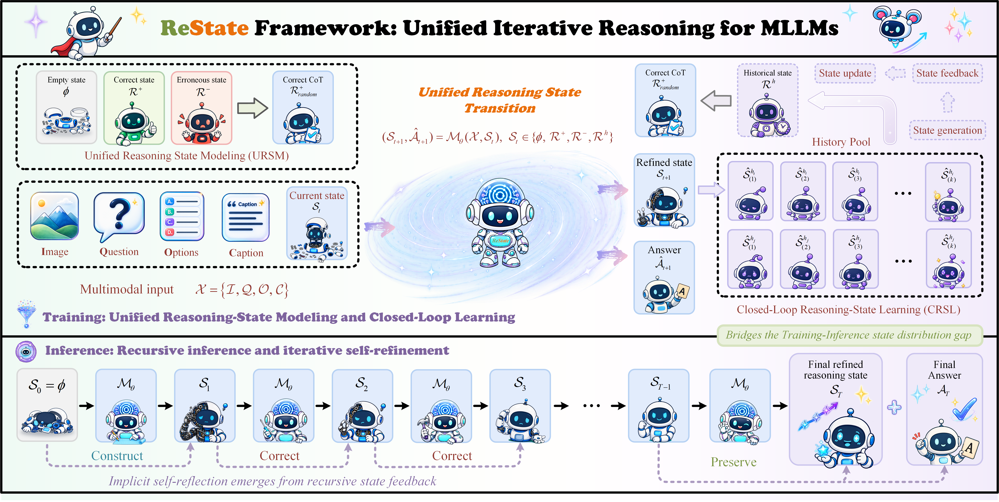
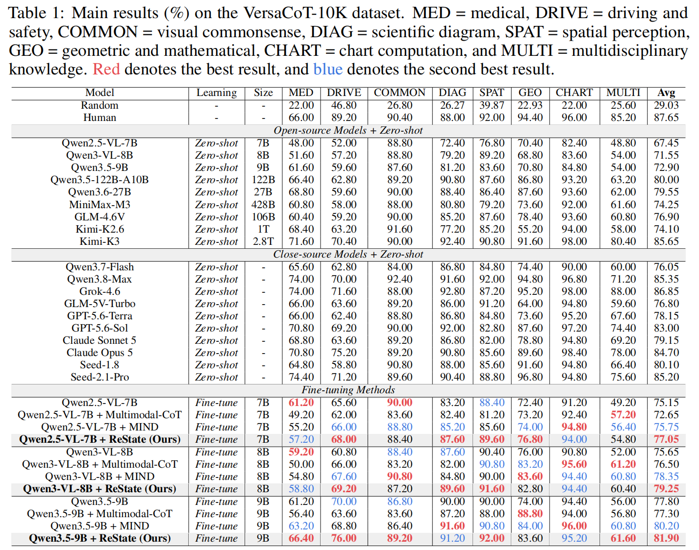
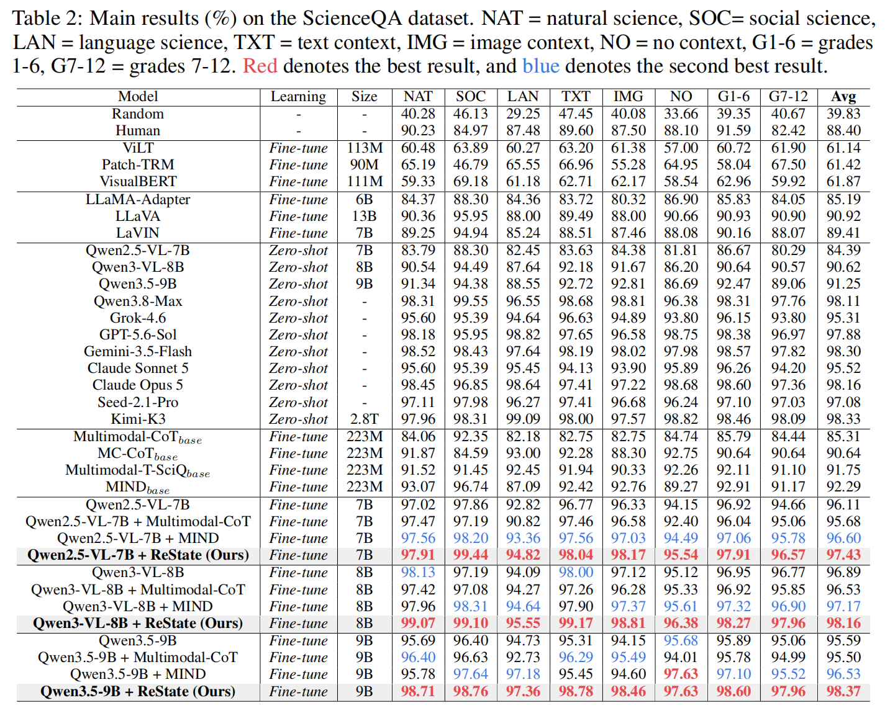
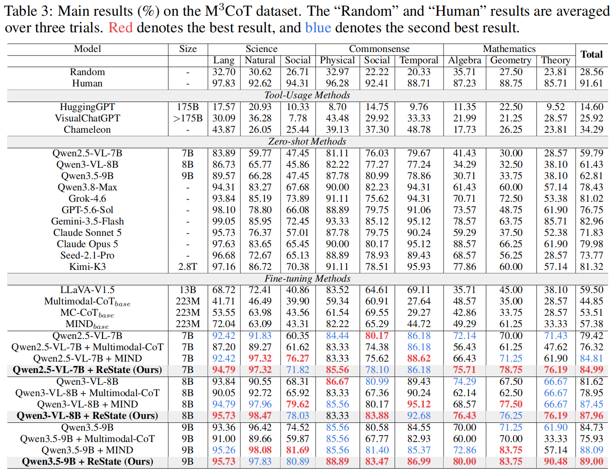

<div align="center">
  <!--  -->
  <h1 style="border-bottom: none;">From Stages to States: Unified Iterative Reasoning for MLLMs</h1>
</div>

<div align="center">
  <p>
    <a href="https://yuchuang1205.github.io/" target="_blank">Chuang Yu</a><sup>1</sup>,&nbsp
    <a href="https://openreview.net/profile?id=~Xuefei_Ma1" target="_blank">Xuefei Ma</a><sup>2</sup>,&nbsp
    <a href="https://scholar.google.com/citations?hl=zh-CN&user=emdXrWoAAAAJ" target="_blank">Yuanhao Feng</a><sup>3</sup>,&nbsp
    <a href="https://scholar.google.com/citations?hl=zh-CN&user=pU_OpsMAAAAJ" target="_blank">Wuxiong Zeng</a><sup>3</sup>,&nbsp
    <a href="https://openreview.net/profile?id=~Bo_Wang50" target="_blank">Bo Wang</a><sup>3</sup>,&nbsp
    <a href="https://onevfall.github.io/personal_page/" target="_blank">Minghong Cai</a><sup>1</sup>,&nbsp
    <a href="https://wudongming97.github.io/" target="_blank">Dongming Wu</a><sup>1</sup>,&nbsp
    <br>
    <a href="https://scholar.google.com/citations?user=Sd2wRM4AAAAJ&hl=zh-CN" target="_blank">Fei Zhou</a><sup>1</sup>,&nbsp
    <a href="https://www.chentang.cc/" target="_blank">Chen Tang</a><sup>1</sup>,&nbsp
    <a href="https://scholar.google.com/citations?hl=zh-CN&user=aGhHuEIAAAAJ" target="_blank">Wenwen Tong</a><sup>4</sup>,&nbsp
    <a href="https://scholar.google.com/citations?user=zdgKJXIAAAAJ&hl=zh-CN" target="_blank">Lewei Lu</a><sup>5</sup>,&nbsp
    <a href="https://xyue.io/" target="_blank">Xiangyu Yue</a><sup>1*</sup>
    
  </p>
  <p>
    <sup>1</sup> MMLab, CUHK &nbsp;&nbsp;
    <sup>2</sup> PolyU &nbsp;&nbsp;
    <sup>3</sup> Tencent &nbsp;&nbsp;
    <sup>4</sup> Peking University &nbsp;&nbsp;
    <sup>5</sup> CPII
  </p>
</div>
<p align="center">
  <a href="https://arxiv.org/abs/2610.15620v1"></a>
  <a href="https://yuchuang1205.github.io/"></a>
  <a href="#"></a>
  <!-- <a href="https://opensource.org/licenses/Apache-2.0"></a> -->
  <!-- <a href="#"></a> -->
  <a href="https://www.python.org/downloads/"></a>
</p>

 
## 🔥 News
-2026.10 🌟🌟 We have released the [**ReState manuscript**](https://arxiv.org/abs/2610.15620v1).  
-2026.10 🌟🌟 We have released the **Complete Code**.  


## 🚀 Overview
<div align="center">
<br>
  
<br>
</div>

## Datasets
* **VersaCoT-10K-RAD** [[The Prepared Dataset](https://pan.quark.cn/s/83f9795101fd)] [[Our original format -- VersaCoT-10K](https://pan.quark.cn/s/5bfd50eff0c9)]
* **ScienceQA-RAD** [[The Prepared Dataset](https://pan.quark.cn/s/91b4e26f51f6)] [[The original paper for the original dataset](https://arxiv.org/abs/2209.09513)]
* **M3CoT-RAD** [[The Prepared Dataset](https://pan.quark.cn/s/d5199dd0e808)] [[The original paper for the original dataset](https://arxiv.org/abs/2405.16473)]  

## How to use our code

1. Download the dataset
   
&nbsp;&nbsp;&nbsp;&nbsp;&nbsp;&nbsp;&nbsp;&nbsp;Click [[download datasets](https://pan.quark.cn/s/83f9795101fd)] 

&nbsp;&nbsp;&nbsp;&nbsp;&nbsp;&nbsp;&nbsp;&nbsp;Unzip the downloaded compressed package to the root directory of the project.

2. Creat a Anaconda Virtual Environment

    ```
    conda create -n ReState python=3.10 
    conda activate ReState 
    ```
3. Configure the running environment
   
   ```
   ##Qwen2.5-VL and Qwen3-VL
    pip install torch==2.6.0 torchvision==0.21.0 torchaudio==2.6.0 --index-url https://download.pytorch.org/whl/cu126
    pip install -r requirements.txt  -i https://mirrors.tencent.com/pypi/simple
    pip install huggingface_hub==0.25.0  -i https://mirrors.tencent.com/pypi/simple
    pip install transformers==4.31.0 -i https://mirrors.tencent.com/pypi/simple
    pip install accelerate -U
    pip install sentence-transformers==5.2.3
    pip  install transformers==4.57.6
    pip install torchmetrics
    pip install termcolor
    pip install numpy==1.26.4
    pip install ijson
    pip install deepspeed
    apt-get update && apt-get install -y libaio-dev
    pip uninstall deepspeed
    pip install deepspeed==0.18.6
    python -c "import nltk; nltk.download('punkt'); nltk.download('punkt_tab')"
   ```
    ```
   ##Qwen3.5-VL  Python 3.11 is recommended.
    pip config set global.index-url https://mirrors.tencent.com/pypi/simple
    pip config set global.extra-index-url https://mirrors.tencent.com/repository/pypi/tencent_pypi/simple
    pip install torch==2.6.0 torchvision==0.21.0 torchaudio==2.6.0 --index-url https://download.pytorch.org/whl/cu126
    pip install -r requirements2.txt  -i https://mirrors.tencent.com/pypi/simple
    pip install huggingface_hub -i https://mirrors.tencent.com/pypi/simple
    pip install transformers -i https://mirrors.tencent.com/pypi/simple
    pip install accelerate -U
    pip install sentence-transformers
    pip  install transformers
    pip install torchmetrics
    pip install termcolor
    pip install numpy==1.26.4
    pip install ijson
    apt-get update && apt-get install -y libaio-dev
    pip install deepspeed==0.18.6
    pip install transformers==5.3.0
    python -c "import nltk; nltk.download('punkt'); nltk.download('punkt_tab')"
   ```
4. Training and test the model  
    ```
    sh ./run.sh --model Qwen/Qwen3-VL-8B-Instruct
    ```


## Results
<div align="center">
<br>
  
<br>
</div>

<div align="center">
<br>
  
<br>
</div>

<div align="center">
<br>
  
<br>
</div>


## Citation

If you find this repo helpful, please give us a 🤩**star**🤩. Please consider citing the **ReState** if it benefits your project. <br>  
<!-- 
BibTeX reference is as follows.
```
####################
```
-->


